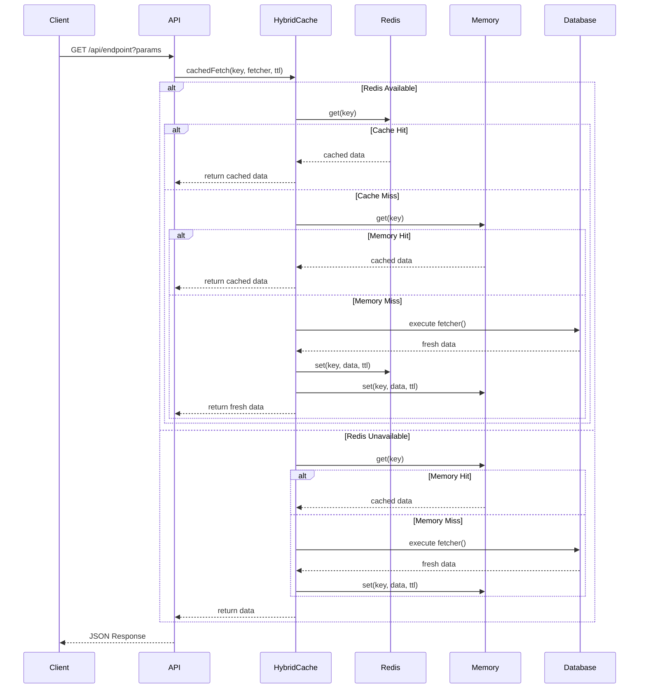

# Design Document: API Caching Implementation

## Overview

Sistem ini akan mengimplementasikan caching layer pada semua GET API endpoints yang belum memiliki cache menggunakan hybrid-cache library yang sudah ada. Implementasi akan menggunakan pattern yang konsisten dengan endpoint yang sudah di-cache (seperti `/api/admin/launchpads`), dengan TTL yang disesuaikan berdasarkan karakteristik data setiap endpoint.

**Tujuan utama:**
- Mengurangi beban database dengan cache hit rate target 90%+
- Meningkatkan response time dari 50-200ms menjadi <5ms untuk cache hits
- Mendukung 10,000+ concurrent users tanpa database connection exhaustion
- Mempertahankan data freshness sesuai dengan karakteristik setiap endpoint

**Strategi implementasi:**
- Gunakan `cachedFetch` wrapper dari hybrid-cache untuk semua GET endpoints
- Generate cache key menggunakan `getCacheKey` dengan path dan query parameters
- Implementasi cache invalidation pada mutation endpoints (POST/PUT/DELETE)
- Fallback otomatis ke in-memory cache jika Redis tidak tersedia

## Architecture

### System Architecture

```
┌─────────────┐
│   Client    │
└──────┬──────┘
       │
       ▼
┌─────────────────────────────────────┐
│      Vercel Edge Cache (CDN)        │
└──────────────┬──────────────────────┘
               │
               ▼
┌─────────────────────────────────────┐
│         API Route Handler           │
│  ┌───────────────────────────────┐  │
│  │   cachedFetch Wrapper         │  │
│  └───────────┬───────────────────┘  │
└──────────────┼──────────────────────┘
               │
               ▼
       ┌───────┴────────┐
       │                │
       ▼                ▼
┌─────────────┐  ┌─────────────┐
│Redis Cache  │  │Memory Cache │
│  (Primary)  │  │ (Fallback)  │
└──────┬──────┘  └──────┬──────┘
       │                │
       │ (miss)         │ (miss)
       ▼                ▼
┌─────────────────────────────────────┐
│         Database Query              │
└─────────────────────────────────────┘
```

### Cache Flow Diagram



## Components and Interfaces

### 1. Hybrid Cache Service

**Location:** `src/lib/hybrid-cache.ts` (existing)

**Interface:**
```typescript
// Main caching function
export async function cachedFetch<T>(
  key: string,
  fetcher: () => Promise<T>,
  ttlSeconds: number = 5
): Promise<T>

// Cache key generation
export function getCacheKey(
  path: string, 
  params: Record<string, any> = {}
): string

// Cache invalidation
export async function invalidateCache(key: string): Promise<void>

// Clear cache with pattern matching
export async function clearAllCache(pattern: string = '*'): Promise<void>
```

**Behavior:**
- Tries Redis first if `REDIS_URL` is configured
- Falls back to in-memory cache if Redis unavailable or fails
- Automatically handles serialization/deserialization
- Fire-and-forget cache writes (non-blocking)

### 2. Cache Wrapper Pattern

**Standard Implementation Pattern:**

```typescript
import { cachedFetch, getCacheKey } from '@/lib/hybrid-cache';

export async function GET(request: NextRequest) {
  try {
    const { searchParams } = new URL(request.url);
    
    // Extract query parameters
    const param1 = searchParams.get('param1');
    const param2 = searchParams.get('param2');
    
    // Generate cache key
    const cacheKey = getCacheKey('/api/endpoint', { 
      param1, 
      param2 
    });
    
    // Wrap database query with cache
    return await cachedFetch(cacheKey, async () => {
      // Original database query logic
      const data = await prisma.model.findMany({
        where: { /* conditions */ }
      });
      
      return NextResponse.json({ 
        success: true, 
        data 
      });
    }, TTL_SECONDS);
    
  } catch (error) {
    // Error handling (errors are NOT cached)
    return NextResponse.json(
      { success: false, error: 'Error message' },
      { status: 500 }
    );
  }
}
```

### 3. Cache Invalidation Pattern

**For Mutation Endpoints:**

```typescript
import { clearAllCache } from '@/lib/hybrid-cache';

export async function POST(request: NextRequest) {
  try {
    const data = await request.json();
    
    // Perform mutation
    await prisma.model.create({ data });
    
    // Invalidate related cache entries
    await clearAllCache('/api/endpoint*');
    
    return NextResponse.json({ success: true });
  } catch (error) {
    // Error handling
    return NextResponse.json(
      { success: false, error: 'Error message' },
      { status: 500 }
    );
  }
}
```

### 4. Endpoint Groups and TTL Configuration

**TTL Strategy Matrix:**

| Endpoint Group | TTL | Rationale | Examples |
|----------------|-----|-----------|----------|
| Static Content | 300s (5min) | Rarely changes, expensive to compute | Banners, Template Bytecode, IPFS content |
| Metadata | 300s (5min) | Immutable after creation | NFT Metadata, Token Metadata |
| Analytics | 30s | Expensive queries, moderate freshness | Admin Stats, Platform Analytics |
| Collections | 10s | Moderate update frequency | Collection List, Collection Details |
| NFT Queries | 10s | Frequently accessed, moderate updates | NFT Details, Contract Info |
| User Holdings | 5s | User-specific, needs freshness | Portfolio, Holdings, Ownership |
| Activity Data | 5s | Frequently updated | Recent Activities, Launchpad List |
| Real-time Data | 1s | Near real-time requirements | Latest Mints, Live Stats |
| Price Data | 10s | External API, rate-limited | Crypto Prices, Floor Prices |
| Whitelist | 30s | Semi-static during mint phases | Whitelist Proofs, Whitelist Lists |

## Data Models

### Cache Entry Structure

```typescript
interface CacheEntry<T> {
  data: T;           // Cached response data
  timestamp: number; // Creation timestamp (ms)
  ttl: number;       // Time to live (ms)
}
```

### Cache Key Format

**Pattern:** `{path}?{sorted_params}`

**Examples:**
```
/api/banners?status=ACTIVE
/api/admin/launchpads?chainId=1&page=1&limit=10&sortBy=createdAt
/api/nft/owner?address=0x123&chainId=1
/api/metadata/0xabc/1
/api/whitelist/proof?address=0x123&contractAddress=0xabc&phaseId=1
```

**Key Generation Rules:**
1. Parameters are sorted alphabetically for consistency
2. Null/undefined parameters are excluded
3. Path parameters are included in the path portion
4. Query parameters are appended with `?` separator
5. Multiple parameters joined with `&`

### Endpoint Inventory

**Endpoints to Cache (by category):**


#### Activity Endpoints
```typescript
// TTL: 1s (real-time)
GET /api/activity/recent

// TTL: 5s (frequent updates)
GET /api/activity/mints-chart

// TTL: 10s (error logs)
GET /api/activity/errors
```

#### Admin Analytics Endpoints
```typescript
// TTL: 30s (expensive queries)
GET /api/admin/analytics/*
GET /api/admin/stats
GET /api/admin/platform-fee/stats
GET /api/admin/platform-fee/history

// TTL: 5s (activity logs)
GET /api/admin/activities

// TTL: 60s (factory info)
GET /api/admin/factory-info
GET /api/admin/factory-details

// TTL: 300s (static bytecode)
GET /api/admin/template-bytecode
```

#### Banner Endpoints
```typescript
// TTL: 300s (static content)
GET /api/banners
GET /api/admin/banners
```

#### Collection Endpoints
```typescript
// TTL: 10s (moderate updates)
GET /api/collections/[address]
GET /api/nft/collections
GET /api/nft/collection/[address]
GET /api/nft/collection/[address]/attributes
```

#### NFT Metadata Endpoints
```typescript
// TTL: 300s (immutable)
GET /api/metadata/[contractAddress]/[tokenId]
GET /api/nft/metadata
GET /api/ipfs/[hash]
```

#### NFT Query Endpoints
```typescript
// TTL: 10s (contract data)
GET /api/nft/[address]/[tokenid]
GET /api/nft/contract/metadata
GET /api/nft/contract/nfts

// TTL: 5s (user-specific)
GET /api/nft/owner
GET /api/nft/owners/token
GET /api/nft/owners/contract
GET /api/nft/holdings
GET /api/nft/portfolio
GET /api/nft/holder
```

#### NFT Attributes and Rarity
```typescript
// TTL: 60s (expensive computation)
GET /api/nft/attributes
GET /api/nft/rarity
```

#### Price and Market Data
```typescript
// TTL: 10s (external API)
GET /api/crypto-price
GET /api/nft/sales

// TTL: 30s (floor price)
GET /api/nft/floor-price
```

#### Whitelist Endpoints
```typescript
// TTL: 30s (semi-static)
GET /api/whitelist/proof
GET /api/whitelist/list
```

#### Search and Spam Check
```typescript
// TTL: 10s (search results)
GET /api/nft/search

// TTL: 60s (spam detection)
GET /api/nft/spam/check
GET /api/nft/spam/contracts
```

#### Airdrop and Promo
```typescript
// TTL: 10s (airdrop eligibility)
GET /api/nft/airdrop/check

// TTL: 30s (promo requests)
GET /api/promo-requests
```

#### Health and RPC
```typescript
// TTL: 5s (health check)
GET /api/health

// TTL: 0s (no cache - proxy endpoint)
GET /api/rpc
```

## Correctness Properties

*A property is a characteristic or behavior that should hold true across all valid executions of a system—essentially, a formal statement about what the system should do. Properties serve as the bridge between human-readable specifications and machine-verifiable correctness guarantees.*


### Property 1: Cache Key Uniqueness

*For any* two requests with different parameters that affect the response, the generated cache keys should be different.

**Validates: Requirements 1.4, 1.5, 2.4, 2.5, 3.4, 3.5, 4.5, 5.6, 5.7, 6.4**

### Property 2: Cache Key Determinism

*For any* request with the same path and parameters, calling `getCacheKey` multiple times should always produce the same cache key.

**Validates: Requirements 11.5**

### Property 3: Cache Key Parameter Sorting

*For any* request with query parameters, the cache key should include parameters in sorted alphabetical order regardless of the order they appear in the request.

**Validates: Requirements 11.2**

### Property 4: Cache Key Completeness

*For any* request, the cache key should include all path parameters and all query parameters that affect the response data.

**Validates: Requirements 11.3**

### Property 5: Cache TTL Correctness

*For any* cached endpoint, the cache entry should expire after the configured TTL duration and not before.

**Validates: Requirements 1.1, 1.2, 1.3, 2.1, 2.2, 2.3, 3.1, 3.2, 3.3, 4.1, 4.2, 4.3, 5.1, 5.2, 5.3, 5.4, 5.5, 6.1, 6.2, 7.1, 7.2, 7.3, 7.4, 8.1, 8.2, 9.1, 9.2, 10.1, 10.2, 10.3**

### Property 6: Cache Hit Consistency

*For any* request, if the same request is made within the TTL period, the second request should return the same data as the first request (cache hit).

**Validates: Requirements 1.1, 1.2, 1.3, 2.1, 2.2, 2.3**

### Property 7: Cache Miss After Expiry

*For any* cached request, if the same request is made after the TTL has expired, the system should fetch fresh data from the database (cache miss).

**Validates: Requirements 1.1, 1.2, 1.3**

### Property 8: Cache Invalidation Completeness

*For any* mutation operation (POST/PUT/DELETE) on an entity, all cache entries matching the invalidation pattern for that entity should be removed.

**Validates: Requirements 12.1, 12.2, 12.3, 12.4**

### Property 9: Mutation Success Independence

*For any* mutation operation, if cache invalidation fails, the mutation should still complete successfully and return success response.

**Validates: Requirements 12.6**

### Property 10: Redis Fallback

*For any* request when Redis is unavailable, the system should successfully use in-memory cache and return correct data.

**Validates: Requirements 13.1**

### Property 11: Cache Failure Non-Blocking

*For any* cache operation (read or write) that fails, the system should continue functioning and return correct data from the database without throwing exceptions.

**Validates: Requirements 13.2, 13.3, 13.5**

### Property 12: Error Response Non-Caching

*For any* request that results in an error response (4xx or 5xx status), the error response should not be cached.

**Validates: Requirements 13.4**

### Property 13: Response Format Preservation

*For any* endpoint after cache implementation, the response format (JSON structure, fields, types) should remain identical to the pre-cache implementation.

**Validates: Requirements 15.1**

### Property 14: Authentication Preservation

*For any* authenticated endpoint after cache implementation, the authentication and authorization checks should still be enforced before serving cached data.

**Validates: Requirements 15.3**

### Property 15: Cache Metrics Accuracy

*For any* sequence of requests, the cache hit and miss counts should accurately reflect the number of cache hits and misses that occurred.

**Validates: Requirements 14.1**

### Property 16: Default TTL Behavior

*For any* cached endpoint where TTL is not explicitly specified, the system should use the default TTL value of 5 seconds.

**Validates: Requirements 16.3**

## Error Handling

### Error Scenarios and Handling Strategy

#### 1. Redis Connection Failure

**Scenario:** Redis server is unavailable or connection fails

**Handling:**
```typescript
// Automatic fallback in hybrid-cache.ts
if (redis) {
  try {
    const cached = await redis.get(key);
    if (cached !== null) return cached;
  } catch (error) {
    console.warn('Redis get failed, falling back to memory cache');
    // Continue to memory cache
  }
}
```

**Behavior:**
- Log warning about Redis unavailability
- Automatically fallback to in-memory cache
- No user-facing error
- System continues functioning normally

#### 2. Cache Read Failure

**Scenario:** Error occurs while reading from cache (serialization error, corrupted data)

**Handling:**
```typescript
try {
  const cached = await cache.get(key);
  if (cached) return cached;
} catch (error) {
  console.error('Cache read failed:', error);
  // Fall through to database query
}

// Fetch from database
const data = await fetcher();
```

**Behavior:**
- Log error with details
- Treat as cache miss
- Fetch fresh data from database
- Attempt to cache the fresh data
- Return correct data to user

#### 3. Cache Write Failure

**Scenario:** Error occurs while writing to cache (memory full, Redis error)

**Handling:**
```typescript
// Fire-and-forget cache writes
if (redis) {
  redis.set(key, data, ttlSeconds).catch((error) => {
    console.error('Cache write failed:', error);
    // Don't throw, just log
  });
}
```

**Behavior:**
- Log error with details
- Don't block response
- Return data to user immediately
- Next request will be cache miss

#### 4. Cache Invalidation Failure

**Scenario:** Error occurs while invalidating cache after mutation

**Handling:**
```typescript
export async function POST(request: NextRequest) {
  try {
    // Perform mutation
    await prisma.model.create({ data });
    
    // Attempt cache invalidation
    try {
      await clearAllCache('/api/endpoint*');
    } catch (error) {
      console.error('Cache invalidation failed:', error);
      // Don't fail the mutation
    }
    
    return NextResponse.json({ success: true });
  } catch (error) {
    // Handle mutation error
    return NextResponse.json(
      { success: false, error: error.message },
      { status: 500 }
    );
  }
}
```

**Behavior:**
- Log invalidation error
- Mutation still succeeds
- Stale cache will expire naturally via TTL
- Return success to user

#### 5. Database Query Failure

**Scenario:** Database query fails during cache miss

**Handling:**
```typescript
return await cachedFetch(cacheKey, async () => {
  try {
    const data = await prisma.model.findMany();
    return NextResponse.json({ success: true, data });
  } catch (error) {
    console.error('Database query failed:', error);
    throw error; // Propagate to caller
  }
}, ttl);
```

**Behavior:**
- Error propagates to API handler
- Return 500 error to user
- Error response is NOT cached
- Next request will retry database query

#### 6. Invalid Cache Key Parameters

**Scenario:** Malformed or invalid parameters passed to getCacheKey

**Handling:**
```typescript
export function getCacheKey(
  path: string, 
  params: Record<string, any> = {}
): string {
  try {
    const sortedParams = Object.keys(params)
      .filter(key => params[key] != null) // Filter null/undefined
      .sort()
      .map(key => `${key}=${encodeURIComponent(params[key])}`)
      .join('&');
    
    return sortedParams ? `${path}?${sortedParams}` : path;
  } catch (error) {
    console.error('Cache key generation failed:', error);
    // Return path only as fallback
    return path;
  }
}
```

**Behavior:**
- Filter out null/undefined values
- Encode parameter values safely
- Fallback to path-only key if error
- Log error for debugging

### Error Logging Strategy

**Log Levels:**
- `console.error()` - Cache failures that might indicate issues
- `console.warn()` - Redis unavailability (expected in some environments)
- `console.log()` - Cache hits/misses for debugging (optional, via env var)

**Log Format:**
```typescript
console.error('[Cache Error]', {
  operation: 'read' | 'write' | 'invalidate',
  key: cacheKey,
  error: error.message,
  timestamp: new Date().toISOString()
});
```

### Graceful Degradation

**Priority Order:**
1. Redis cache (fastest, shared)
2. In-memory cache (fast, per-instance)
3. Database query (slowest, always works)

**Degradation Path:**
```
Redis Error → Memory Cache → Database
Memory Error → Database
Database Error → Return 500 Error
```

## Testing Strategy

### Dual Testing Approach

This feature requires both unit tests and property-based tests to ensure comprehensive coverage:

**Unit Tests** focus on:
- Specific examples of cache key generation
- Edge cases (empty parameters, special characters)
- Error conditions (Redis down, invalid data)
- Integration points (cache + database)
- Specific endpoint implementations

**Property-Based Tests** focus on:
- Universal properties across all inputs
- Cache key uniqueness and determinism
- TTL expiration behavior
- Cache invalidation completeness
- Fallback mechanisms

Both testing approaches are complementary and necessary for comprehensive coverage.

### Property-Based Testing Configuration

**Library:** Use `fast-check` for TypeScript/JavaScript property-based testing

**Installation:**
```bash
npm install --save-dev fast-check @types/fast-check
```

**Configuration:**
- Minimum 100 iterations per property test
- Each test must reference its design document property
- Tag format: `Feature: api-caching-implementation, Property {number}: {property_text}`

**Example Property Test Structure:**
```typescript
import fc from 'fast-check';

describe('Feature: api-caching-implementation', () => {
  it('Property 1: Cache Key Uniqueness', () => {
    fc.assert(
      fc.property(
        fc.record({
          path: fc.string(),
          params1: fc.dictionary(fc.string(), fc.string()),
          params2: fc.dictionary(fc.string(), fc.string())
        }),
        ({ path, params1, params2 }) => {
          // Test that different params produce different keys
          const key1 = getCacheKey(path, params1);
          const key2 = getCacheKey(path, params2);
          
          if (JSON.stringify(params1) !== JSON.stringify(params2)) {
            expect(key1).not.toBe(key2);
          }
        }
      ),
      { numRuns: 100 }
    );
  });
});
```

### Unit Testing Strategy

**Test Categories:**

#### 1. Cache Key Generation Tests
```typescript
describe('getCacheKey', () => {
  it('should generate consistent keys for same inputs', () => {
    const key1 = getCacheKey('/api/test', { a: '1', b: '2' });
    const key2 = getCacheKey('/api/test', { a: '1', b: '2' });
    expect(key1).toBe(key2);
  });
  
  it('should sort parameters alphabetically', () => {
    const key1 = getCacheKey('/api/test', { b: '2', a: '1' });
    const key2 = getCacheKey('/api/test', { a: '1', b: '2' });
    expect(key1).toBe(key2);
  });
  
  it('should handle special characters', () => {
    const key = getCacheKey('/api/test', { addr: '0x123&abc' });
    expect(key).toContain(encodeURIComponent('0x123&abc'));
  });
  
  it('should exclude null and undefined parameters', () => {
    const key = getCacheKey('/api/test', { a: '1', b: null, c: undefined });
    expect(key).toBe('/api/test?a=1');
  });
});
```

#### 2. Cache Behavior Tests
```typescript
describe('cachedFetch', () => {
  it('should cache successful responses', async () => {
    let callCount = 0;
    const fetcher = async () => {
      callCount++;
      return { data: 'test' };
    };
    
    await cachedFetch('test-key', fetcher, 5);
    await cachedFetch('test-key', fetcher, 5);
    
    expect(callCount).toBe(1); // Second call should hit cache
  });
  
  it('should not cache error responses', async () => {
    let callCount = 0;
    const fetcher = async () => {
      callCount++;
      throw new Error('Test error');
    };
    
    await expect(cachedFetch('test-key', fetcher, 5)).rejects.toThrow();
    await expect(cachedFetch('test-key', fetcher, 5)).rejects.toThrow();
    
    expect(callCount).toBe(2); // Both calls should execute
  });
  
  it('should expire cache after TTL', async () => {
    let callCount = 0;
    const fetcher = async () => {
      callCount++;
      return { data: callCount };
    };
    
    const result1 = await cachedFetch('test-key', fetcher, 1);
    await new Promise(resolve => setTimeout(resolve, 1100));
    const result2 = await cachedFetch('test-key', fetcher, 1);
    
    expect(result1.data).toBe(1);
    expect(result2.data).toBe(2);
  });
});
```

#### 3. Cache Invalidation Tests
```typescript
describe('Cache Invalidation', () => {
  it('should invalidate specific cache key', async () => {
    await cachedFetch('test-key', async () => ({ data: 'test' }), 60);
    await invalidateCache('test-key');
    
    // Next fetch should be cache miss
    let fetched = false;
    await cachedFetch('test-key', async () => {
      fetched = true;
      return { data: 'new' };
    }, 60);
    
    expect(fetched).toBe(true);
  });
  
  it('should clear cache with pattern matching', async () => {
    await cachedFetch('/api/test/1', async () => ({ data: '1' }), 60);
    await cachedFetch('/api/test/2', async () => ({ data: '2' }), 60);
    await cachedFetch('/api/other/1', async () => ({ data: '3' }), 60);
    
    await clearAllCache('/api/test*');
    
    // Test keys should be cleared, other key should remain
    // Verify by checking cache misses
  });
});
```

#### 4. Endpoint Integration Tests
```typescript
describe('GET /api/banners', () => {
  it('should cache banner responses', async () => {
    const req1 = new NextRequest('http://localhost/api/banners?status=ACTIVE');
    const res1 = await GET(req1);
    const data1 = await res1.json();
    
    // Modify database
    await prisma.banner.create({ /* test data */ });
    
    // Should still get cached response
    const req2 = new NextRequest('http://localhost/api/banners?status=ACTIVE');
    const res2 = await GET(req2);
    const data2 = await res2.json();
    
    expect(data1).toEqual(data2);
  });
  
  it('should use different cache for different parameters', async () => {
    const req1 = new NextRequest('http://localhost/api/banners?status=ACTIVE');
    const req2 = new NextRequest('http://localhost/api/banners?status=INACTIVE');
    
    const res1 = await GET(req1);
    const res2 = await GET(req2);
    
    const data1 = await res1.json();
    const data2 = await res2.json();
    
    expect(data1).not.toEqual(data2);
  });
});
```

#### 5. Error Handling Tests
```typescript
describe('Error Handling', () => {
  it('should fallback to memory when Redis unavailable', async () => {
    // Mock Redis failure
    process.env.REDIS_URL = 'redis://invalid:6379';
    
    const result = await cachedFetch('test-key', async () => {
      return { data: 'test' };
    }, 5);
    
    expect(result.data).toBe('test');
  });
  
  it('should not fail mutation when cache invalidation fails', async () => {
    // Mock cache invalidation failure
    const originalClear = clearAllCache;
    (global as any).clearAllCache = async () => {
      throw new Error('Cache clear failed');
    };
    
    const req = new NextRequest('http://localhost/api/admin/banners', {
      method: 'POST',
      body: JSON.stringify({ /* test data */ })
    });
    
    const res = await POST(req);
    const data = await res.json();
    
    expect(data.success).toBe(true);
    
    // Restore
    (global as any).clearAllCache = originalClear;
  });
});
```

### Test Coverage Goals

- **Line Coverage:** 90%+ for cache-related code
- **Branch Coverage:** 85%+ for error handling paths
- **Property Tests:** All 16 correctness properties implemented
- **Integration Tests:** All endpoint groups covered

### Testing Execution

**Run all tests:**
```bash
npm test
```

**Run property tests only:**
```bash
npm test -- --testNamePattern="Property"
```

**Run with coverage:**
```bash
npm test -- --coverage
```

### Continuous Integration

**Pre-commit:**
- Run unit tests
- Check code formatting

**Pull Request:**
- Run all tests including property tests
- Generate coverage report
- Require 90%+ coverage for new code

**Deployment:**
- Run full test suite
- Verify cache configuration
- Check Redis connectivity (optional)

